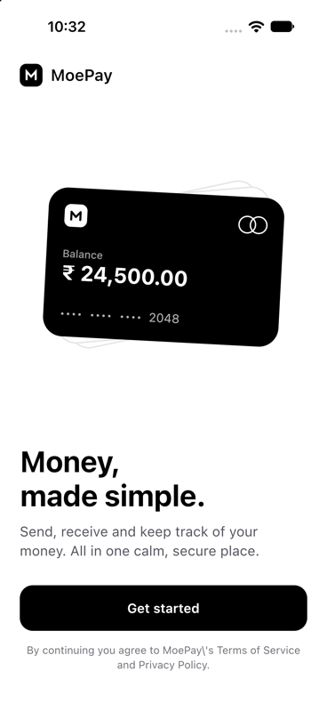
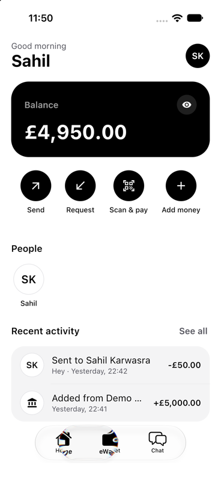
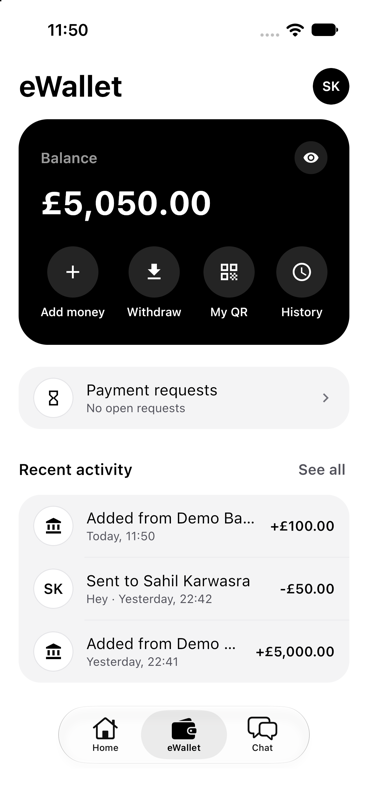
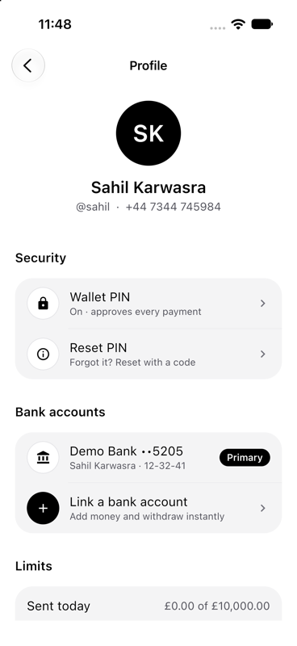
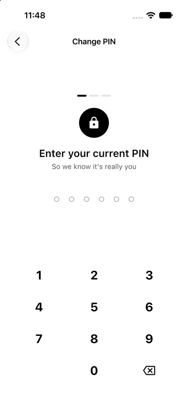
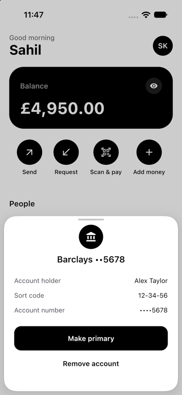
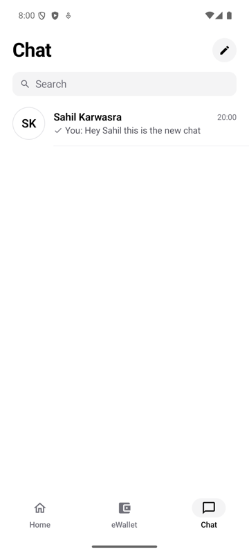
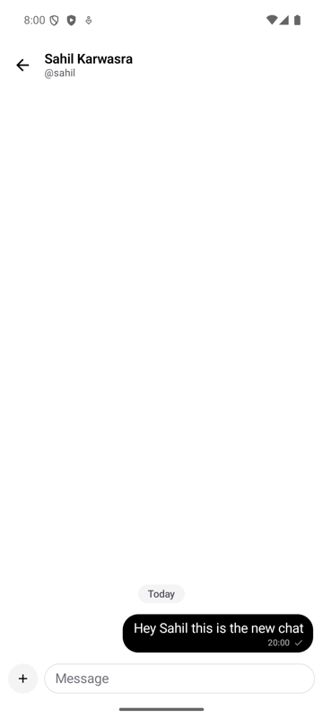

# MoePay

A minimal, monochrome GBP e-wallet for **Android and iOS**, built once with Kotlin and Compose Multiplatform.
Send and request money, scan QR codes, keep a wallet behind a PIN, and chat with the people you pay,
with a chat that keeps working offline.

On iOS the navigation bar, tab bar, sheets, alerts and action sheets are real UIKit controls
(`UINavigationBar`, `UITabBar`, `UISheetPresentationController`, `UIAlertController`). On Android the same
screens use their Material 3 counterparts.

This is the client for [MoePay-Backend](../MoePay-Backend).

<p align="center">
  
  
  
  
</p>
<p align="center">
  
  
  
  
</p>

---

## Features

| Area | What you can do |
|---|---|
| **Sign-in** | Welcome, then a UK mobile number (+44) and a one-time code. Sessions are refreshed silently. |
| **Onboarding** | Name, a unique `@username` (checked live), then a review step. It resumes at whatever step the backend says is next. |
| **Home** | Balance card (tap the eye to hide it, the digits roll when it changes), quick actions, recent people, recent activity, pull to refresh. |
| **eWallet** | Add money, withdraw, My QR, history, payment requests and recent activity. |
| **Profile** | Your details, wallet PIN (set, change, reset with a code), linked bank accounts, spending limits, log out. |
| **Send and request** | Find someone by `@username` or UK mobile number, enter an amount, review, confirm with your PIN. |
| **Scan and pay** | Native QR scanner (VisionKit on iOS, Google Code Scanner on Android) with a paste fallback. `moepay://pay` links open the same flow. |
| **Payment requests** | Incoming and outgoing lists, with pay, decline and cancel. |
| **Activity** | Full history grouped by day, with filters and a detail screen for every transaction. |
| **Chat** | One-to-one chats, offline-first (see below). Money can be sent and requested inside a conversation. |
| **Live updates** | A WebSocket pushes balance changes, new requests, chat messages and typing, with an in-app banner for money events. |

## Architecture

Multi-module clean architecture. Every feature is split into layers, and the dependency rule is strict:

```
presentation ──▶ domain ◀── data
     │                        │
     └──▶ core:ui / core:presentation / core:designsystem
```

- `domain` is plain Kotlin: models, repository interfaces, business rules. No Ktor, Room or Compose.
- `data` implements the domain interfaces (Ktor, DataStore, Room) and maps DTOs to domain models.
- `presentation` is Compose + ViewModels. It never touches DTOs or the network.
- **Features never depend on each other.** Cross-feature navigation is wired in `:shared`
  (`NavigationRoot`), which maps each feature's destinations to routes.

### Modules

```
build-logic/convention     Gradle convention plugins: kmp.library, cmp.library, cmp.feature,
                           cmp.application, android.application, app.config, room
androidApp                 Android entry point (Application with Koin, MainActivity, deep links)
iosApp                     Xcode project: SwiftUI shell, launch screen, VisionKit scanner bridge
shared                     Composition root: App, MainTabs, NavigationRoot, Koin setup, realtime banner

core/domain                Result and DataError, auth/session, money, wallet, realtime and connectivity contracts
core/data                  Ktor client (envelope parsing, bearer + refresh, idempotency), WebSocket client,
                           encrypted session storage, DataStore preferences, connectivity monitors
core/presentation          UiText, error-to-message mapping, money/date/phone formatting
core/designsystem          Theme, components, motion, icons, native/ (expect/actual bars, sheets, haptics)
core/ui                    Domain-aware shared UI: transaction rows, PIN sheet, amount entry, result screens

feature/auth               welcome, phone number, one-time code
feature/onboarding         profile, username, review
feature/home               dashboard (domain, data, presentation)
feature/wallet             eWallet tab, PIN flow, banks, add/withdraw, My QR, profile
feature/payments           send, request, scan, payment requests
feature/activity           history and transaction detail
feature/chat               domain, database (Room), data (sync + outbox), presentation
```

### Screens

Each screen is a `State` / `Action` / `Event` triple with a ViewModel, split into a `XRoot`
(ViewModel, events, navigation lambdas) and a stateless `XScreen(state, onAction)` that previews and tests
easily. ViewModels load their data on first collection (`onStart` + `hasLoadedInitialData`) so rotation and
navigation never reload.

## Chat: offline-first

The device database is the single source of truth. The UI only observes it; the network only writes into it.

```
UI (ViewModels) ──observe──▶ Room (Flows) ◀──upsert── ChatSyncEngine ◀── /chat/sync, WebSocket
      │                         ▲
      └─ write intent ─▶ ChatRepository ─▶ outbox ─▶ OutboxProcessor ─▶ REST
```

- **Write locally first.** A message is saved on the device with a client-generated id and shows immediately
  with a clock; it turns into the server's copy in place when delivered. Because the id is also the
  idempotency key, resending after a dropped connection can never create a duplicate.
- **One cursor to sync.** The backend keeps an ordered, gap-free change feed per user. Each page is applied
  in a single Room transaction together with the new cursor, so a crash can't skip changes. Pushed
  `chat.changes` events apply directly when they continue the cursor and fall back to a pull when they don't.
- **Outbox.** Sends, edits, deletes and read receipts are queued, kept in order per conversation, retried with
  backoff, and honour the server's `retry_after_seconds`. Permanent failures are shown under the bubble with
  retry and discard. Read receipts are coalesced to the highest seq.
- **Edits and deletes** are shown at once. If the server refuses (window passed, changed on another device),
  its copy is restored.
- **Money in chat.** Requests are queued like messages. Sending money needs the PIN, which is never stored,
  so it needs a connection.
- **Typing** is ephemeral: throttled to one signal every 3 seconds and expiring on its own.
- **Privacy.** Signing out wipes the chat database and cursor.

## Money safety

- Amounts are integer **pence** end to end; the UI shows the server's own display strings.
- Every money-moving POST carries an `Idempotency-Key`. A key is reused while the user retries the same
  payment and replaced after a definitive result, so a retry can never pay twice.
- PIN errors keep their details (attempts remaining, lock expiry) and are never retried automatically.
  The PIN lives only inside the PIN pad and is never held in screen state.
- Tokens are stored encrypted: iOS Keychain, or AES-GCM with an Android Keystore key.

## Tech stack

| | |
|---|---|
| Language and UI | Kotlin 2.4.20, Compose Multiplatform 1.12.1, Material 3, type-safe Navigation |
| Android | AGP 9.1.1 (`com.android.kotlin.multiplatform.library`), minSdk 26, compileSdk 37 |
| iOS | Xcode project with a SwiftUI shell; iOS 18.2+ (iOS 26 UI such as the navigation subtitle is used when available) |
| DI | Koin 4.2.2 |
| Networking | Ktor 3.6.0 (OkHttp on Android, Darwin on iOS), WebSockets, kotlinx.serialization |
| Local data | Room 2.8.5 with the bundled SQLite driver, DataStore 1.3.0 |
| Other | kotlinx.coroutines, kotlinx.datetime, Kermit logging, qrose (QR codes), Google Code Scanner (Android) |

## Getting started

**You need:** Android Studio (or JDK 17+), Xcode for iOS, and the backend running.

### 1. Start the backend

In [`MoePay-Backend`](../MoePay-Backend):

```bash
make migrate   # applies every migration, including chat (00008)
make run       # http://localhost:8080
```

For a UK app set `PHONE_DEFAULT_REGION=GB` in the backend `.env`. In development the one-time code is printed
in the backend log (`DEV ONLY: OTP`).

### 2. Point the app at it (optional)

The defaults target a backend on the same machine. Override them in `local.properties` (git-ignored):

```properties
MOEPAY_BASE_URL_ANDROID=http://10.0.2.2:8080
MOEPAY_BASE_URL_IOS=http://localhost:8080
```

### 3. Run

```bash
# Android
./gradlew :androidApp:assembleDebug        # or run `androidApp` from Android Studio

# iOS: open iosApp/iosApp.xcodeproj in Xcode and run the `iosApp` scheme
```

The iOS build runs Gradle from Xcode, so Java must be available. If Xcode says it can't locate a Java Runtime,
set `JAVA_HOME` (Android Studio's bundled JDK works):

```bash
export JAVA_HOME="/Applications/Android Studio.app/Contents/jbr/Contents/Home"
```

### 4. Test

```bash
./gradlew iosSimulatorArm64Test            # shared unit tests (needs Xcode selected)
```

Tests cover amount input and money formatting, UK phone parsing, idempotency keys, error mapping, session
storage and migration, the chat sync engine, outbox, mappers, timeline grouping and edit/delete rules.

## Trying it out

- Sign in with a UK mobile number and read the code from the backend log.
- Link a bank account with sort code `12-34-56` and account number `12345678`, then add money.
- The dummy bank declines accounts ending `0000` and reports accounts ending `9999` as unavailable, which
  is handy for testing failure screens.
- Use two accounts (for example a simulator and an emulator) to try sending, requesting and chatting.

## Deep links

| Link | Opens |
|---|---|
| `moepay://pay?u=alex&a=500` | Send flow to `@alex`, prefilled (amount in pence) |
| `moepay://chat?u=alex` | Chat with `@alex` |

## Troubleshooting

| Problem | Fix |
|---|---|
| "Something went wrong on our side" when starting a chat | The backend database is missing the chat migration. Run `make migrate` in MoePay-Backend. |
| iOS build fails with "Unable to locate a Java Runtime" | Set `JAVA_HOME` as above. |
| The app can't reach the backend | Check the base URLs. The Android emulator reaches your computer at `10.0.2.2`. |
| Codes never arrive | In development they are only logged by the backend (`DEV ONLY: OTP`). |

## Adding a feature

1. Create `feature/<name>/{domain,data,presentation}` and `include(...)` them in `settings.gradle.kts`.
2. Use `convention.kmp.library` for domain and data, `convention.cmp.feature` for presentation
   (plus `convention.room` for a database module).
3. Build screens as `XRoot` + stateless `XScreen(state, onAction)` with a State/Action/Event ViewModel.
4. Register the Koin modules in `shared/.../di/initKoin.kt` and the routes in `NavigationRoot`.

## Related

The backend API, the chat sync protocol and the error codes are documented in the README of
[MoePay-Backend](../MoePay-Backend).
